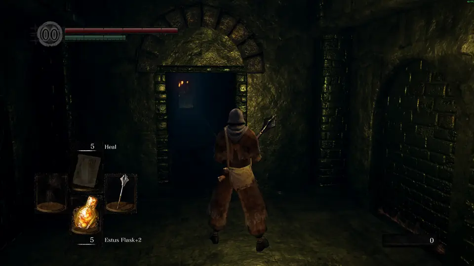

<p align="center">
  
</p>

<p align="center">
  <a href="https://github.com/vladi245/dsr-pathfinder/releases/latest"></a>
  
  
  
  
  <a href="LICENSE"></a>
</p>

<p align="center">
  A guide overlay for getting <b>100% of the achievements</b> (the <b>platinum trophy</b>) in Dark Souls Remastered.
</p>

<p align="center">
  <b><a href="https://github.com/vladi245/dsr-pathfinder/releases/latest">Download the latest release</a></b>
</p>

## What it looks like

<p align="center">
  
</p>

## About

DSR Pathfinder exists for one thing: getting every achievement in Dark Souls Remastered
(Steam, PC), the **100% achievements / platinum trophy** run. It walks you through a complete 100% walkthrough step by step: every spell for Wisdom of a Sage, Bond of a Pyromancer and Prayer of a Maiden, every weapon for Knight's Honor, every covenant, boss and ending, in an order that doesn't miss anything along the way.

It shows the current step in a panel at the top right, and lays the walking route on the ground
as a band of light, from your feet to the next destination, with a beacon over the destination. When the destination is off screen, an arrow at the screen edge points to it. Until the camera is found, a compass at the top center points the way instead.

The trail is drawn **inside the game's own frames**: the app loads a small renderer
(`DSRPathfinderHook-*.dll`) into the game, which hooks Direct3D 11's frame presentation and paints
the path onto the actual floor using the game's depth buffer. It follows stairs and slopes,
moves exactly with the camera, and walls and enemies in front of it cover it. Everything else is
read from the game's memory (your position, the camera and event flags); nothing in the game is
changed. Untick **Trail → Draw it inside the game** in the tray menu for an overlay that only reads
memory; the trail is then drawn in the overlay window instead.

**Play offline** while using it. Any tool attached to a From Software game while you're online
carries some risk, more so one that loads into the game. You still get the achievements even if you are playing in offline mode.

## Setup

1. Download `DSRPathfinder.exe` from the [latest release](https://github.com/vladi245/dsr-pathfinder/releases/latest)
   and run it. That's the whole app: the guide and everything else are built in.
2. If Dark Souls Remastered isn't running, the app starts it through Steam. The app is in the    hidden icons, right-click it for settings, to hide the overlay or to quit.
3. In the game, set the screen mode to **windowed or borderless** (once). The trail shows in any
   mode, but the step panel is a window over the game, and a window can't be drawn over a true
   exclusive-fullscreen game. The overlay only shows while the game window has focus.

Windows may warn about an unknown app the first time (**More info → Run anyway**): that is jsut because the exe isn't signed.

### Settings

Everything you'd want to change is in the **tray icon's menu** (right-click it), and takes effect
right away:

- **Trail**: show or hide it, pick its style, draw it inside the game or in the overlay window,
  and lay it on the ground behind walls or flat on top.
- **Compass**: when it shows (only without the trail, always or never), and recalibrate it.
- **Calm mode**: the guide steps back while you follow the route.
- **Start the game with the app.**

The menu saves your choices to `config.ini`. A few rarely needed numbers live only there
(**Edit the settings file...** in the menu opens it): `camera_fov`, `waypoint_radius`,
`arrow_mirror`. Edits to the file apply as soon as you save it.

Your files (settings, your place in the guide, waypoints you record, a log) are in
`%APPDATA%\DSR Pathfinder`; the icon's menu opens the folder and the settings. A newer version of
the app brings its newer guide and keeps the waypoints you recorded (your old copy is saved as
`guide.previous.txt`). For a portable copy instead, put a `config.ini` next to the exe: it then
keeps everything in that folder.

If you want to remove the app, just delete the appdata folder and the exe. (The renderer DLL is in
that folder too; while the game is running it's in use, so close the game first.)

### First run: turn the camera

To draw the trail, the overlay has to find the game's camera in memory. There's no fixed address
for it, so on first load the panel says *"Finding the camera…"*. **Stand still and turn the camera
around** (mouse or right stick) for a second or two. The trail appears once it's found. It's
found again by itself after loading screens; if it ever disappears for good, turn the camera
again. F11 shows the camera status.

### Compass calibration (only without the trail)

The game's facing-angle convention isn't documented, so the overlay learns it. When you first load
in, the panel says *"Calibrating compass…"*. **Run in a straight line for a few seconds** (a
couple of directions helps). The overlay then shows "Compass calibrated" and saves the result to
`config.ini`. **Compass → Recalibrate** in the tray menu (or Shift+F11) redoes it.

If the arrow turns the **wrong way** when you turn, set `arrow_mirror = 1` in `config.ini`.

### Trail style

**Trail** in the tray menu picks how the trail looks (it's `trail_style` in `config.ini`).
Everything is pinned to the route, so it doesn't slide along with you.

| `trail_style` | Look |
|---|---|
| `stream` (default) | a band of light painted onto the ground, with brighter edges, waves running to the destination, chevrons drifting forward and sparks rising off it; a ring on the ground marks the destination |
| `pulse` | still lights with soft waves of light travelling towards the destination |
| `embers` | scattered embers drifting forward, each flickering, with a short glowing tail |
| `wisps` | two strands of tiny lights spiralling along the path |
| `fireflies` | sparse lights that fade in, wander, drift forward and fade out |
| `line` | a solid line (drawn by the overlay window) |

`stream` needs the in-game renderer; without it (**Draw it inside the game** unticked, or if it
can't load) it shows as `pulse`. Where something hides the path, a faint ghost of it shows
through, so you don't lose it. Unticking **Lay it on the ground, behind walls** turns the depth
buffer off: the band is then drawn flat along the route.

### Calm mode

So the guide doesn't take over the screen, it steps back while you're simply following it:
walking along the route, the trail softens and the step panel dims to the area and instruction.
Stand still for a moment, arrive, start a new step or leave the route, and it all comes back in
full. The trail starts a couple of metres ahead of you, is clear for the next 30 m and then fades
out, while the beacon keeps marking the destination. Untick **Calm mode** in the tray menu to keep
everything at full strength.

## Hotkeys (only while the game is focused)

| Key       | Action                                                  |
|-----------|---------------------------------------------------------|
| F5 / F6   | Previous / next step                                    |
| F7        | Record a waypoint at your current position              |
| F8        | Remove the last waypoint of this step                   |
| F9        | Hide / show the overlay                                 |
| F10       | Reload `guide.txt` (edit it while playing)              |
| F11       | Debug info (position, flags, camera, in-game renderer)  |
| Shift+F11 | Redo compass calibration                                |

Your current step is saved in `progress.txt`.


### Following your walkthrough

If `tools/walkthrough.txt` exists, the guide follows it step by step, in your order. The format
is numbered sections ("7. Blighttown and Quelaag's Domain") with numbered steps under each.
Wherever a step names something the game data can locate, it gets destinations and auto-complete
flags:

- **Items**: "Collect Havel's Set, Havel's Greatshield and Dragon Tooth" gets four destinations,
  and the step ticks off once all four pickups are done.
- **Armor sets**: "the Sorcerer Set" expands to every piece of that set nearby.
- **Bosses, NPCs and enemies**, located where the game spawns them: "Defeat the Taurus Demon"
  points at its arena, "Speak with Oscar" at Oscar.
- When a name exists in several places, it takes the one on the way (see below).
- Mentions of items you already carry ("give him the Large Ember", "buy the Residence Key",
  "with the Master Key") aren't destinations, but the person you give or buy from is.

541 of the 610 walkthrough steps have a destination of their own (584 of all 654 steps). A step
without one leads the trail on to the next step that has one.
Achievement items the walkthrough never sends you to are added after it: farming spots, spell
shops, boss-soul recipes and covenant rewards. That keeps the 100% list complete. Step IDs are
section + step number, so editing one section doesn't lose waypoints recorded in another.
Pass `--walkthrough ""` to build the area-by-area guide instead.

The walkthrough comes from the [hundodex Dark Souls walkthrough](https://darksouls.hundodex.com/journey/walkthrough).


### Routes

Walking routes are **computed from the game's own navigation meshes** (`tools/navmesh.py`).
These are the walkable surfaces enemy AI uses, and every map ships them. The generator loads all
80,000 or so triangles and joins mesh pieces where they meet. It adds small gaps and safe drops
of up to 7 m (one way, down only); ladders are already part of the meshes. Then it finds the
shortest walk from each destination to the next and pulls it tight into a natural line, with a
point every 8 m or so. The arrow follows that route instead of pointing through walls.

The 698 destinations get about 26,100 route points. A route only cuts a corner where the
straight line stays on one connected stretch of floor, so stairs and stacked floors keep their
turns. A few destinations stay straight-line: the first one after a crow, painting, portal or
bonfire warp (nothing to walk), and area changes where walking would be a huge detour. If a
route is wrong, **press F7** along the right way. Your waypoints replace that step's computed
route, and **regenerating keeps them**. `--no-routes` skips routing.

**Routing from where you are.** The guide's routes start where the previous step ended. If you're
somewhere else, say back at a bonfire after dying or a Homeward Bone, more than 25 m from the
route, the overlay works out a walking route from you to the next destination with the same
meshes and follows that, and switches back once you're on the guide's route. The generator
writes the joined meshes to `navmesh.bin` (about 10 MB) next to `guide.txt`, and `build.bat`
builds it into the exe.

### Step format

```ini
[step]
id = weapon-211000-m10_01_00_00-1   # stable key, used to keep your waypoints on regenerate
title = Undead Burg: Drake Sword
text = Description; repeat the key for more lines.
warning = Shown in red: missables, points of no return.
flag = 51010000, 51010010           # optional: step ticks off when all these flags are on
radius = 6                          # optional: arrival distance in metres
wp = 101.20, -34.10, 88.00          # route you recorded (F7); replaces the computed path
path = 110.00, -32.50, 91.20        # computed walking route to the next goal
goal = 120.55, -30.02, 95.10        # destinations, visited in order
path = 123.10, -30.02, 97.00
goal = 125.00, -30.02, 99.40
```

### Check this first: coordinates

Map files store positions in one shared world space. Some maps also carry a "map offset", but
adding it breaks how neighbouring maps' navmeshes meet, so it's not applied. **On first launch,
press F11 near a step's destination and compare `pos` with that step's `goal` numbers** in
`guide.txt`; they should match within a few metres. If they're off by a constant amount in one
area, regenerate with `--map-offsets` and compare again.

### Event flags

When a step has `flag = <id>`, the overlay watches that flag and moves to the next step when the
flag turns on, for example when an item is picked up or a boss dies. Going forward with F6 also
skips steps whose flag is already on. The IDs are 8-digit numbers. F11 shows the current state of
the step's flag, which is useful for checking an ID you found.

## Troubleshooting

- **"Finding the camera…" never goes away:** turn the camera a full half circle while standing
  still, not locked on. If it still isn't found, F11 shows how many candidates the scan found;
  please report that line. Untick **Trail → Show the trail** to use the compass meanwhile.
- **The trail floats over the ground or slides as you turn:** the field of view is off. F11's
  camera lines show the one in use and the candidates found; try `camera_fov = 43` (or nearby
  values) in `config.ini`.
- **The trail is a flat band over everything, not on the floor:** the renderer has no depth. F11's
  in-world lines say why ("no depth", "occlusion needs the game's projection"); please report them.
- **The game crashes or the trail misbehaves after an update:** untick **Trail → Draw it inside
  the game** in the tray menu. The overlay window then draws the trail, as a read-only overlay.
- **Console says "Game found, waiting for it to finish starting…" forever:** the memory patterns
  didn't match, probably because of a game update. Please report the game version.
- **Overlay never appears:** the game is in exclusive fullscreen, or the overlay isn't the
  foreground window. Switch to windowed or borderless.
- **"Waiting for your character to load…" in game:** the position pointer didn't resolve. Turn
  on F11 and check whether `pos` changes as you move.

## How it works

- `src/game.cpp` finds the game's `WorldChrBase` and event-flag managers by byte-pattern scan.
  It follows `WorldChrBase → player → ChrMapData → ChrPosData` to get X/Y/Z and facing. Patterns
  and offsets come from [DSR-Gadget](https://github.com/JKAnderson/DSR-Gadget).
- `src/overlay.cpp` draws the panel, compass and beacon with GDI+ into a click-through,
  per-pixel-alpha window laid over the game's client area.
- `src/hook/hook.cpp` is the in-game renderer, built into the exe and loaded into the game by
  `src/inworld.cpp`. It hooks `IDXGISwapChain::Present`, finds the scene's depth buffer (the game
  records its scene on deferred contexts, so their render-target binds are hooked in d3d11.dll's
  code), reads the camera every frame and draws the trail with shaders: each pixel near the route
  rebuilds its world position from depth and lights up if it lies on the path. The trail and the
  camera's whereabouts come from the app through shared memory (`src/trailshare.h`).
- `src/motes.cpp` places the lights of each trail style, for both the window and the renderer.
- `src/camera.cpp` finds the camera without a fixed address. A background thread scans the game's
  writable memory for 4x4 rigid transforms whose eye is a few metres from the player and looking
  at them. The one that keeps doing that while you turn the camera is the camera. Its projection
  matrix (field of view) is found the same way. `src/overlay.cpp` projects the route through
  both and draws it.
- `src/nav.cpp` handles the heading calibration (fits facing angle against running direction)
  and route following.
- `src/route.cpp` routes from wherever you are over `navmesh.bin`: A* across the joined meshes,
  then the same corner-cutting as `tools/navmesh.py`, on a background thread (a few ms a route).
- `src/guide.cpp` parses `guide.txt` and records waypoints into it.
- `tools/dsr_formats.py` reads the game's DCX/BND3 archives, PARAM tables (laid out with the
  game's own PARAMDEFs), FMG text and MSB maps. `tools/build_guide.py` turns them into the guide,
  `tools/walkthrough.py` matches walkthrough steps to places in the game, and
  `tools/navmesh.py` computes walking routes over the NVM navigation meshes.

## Credits

- Step order and step text: [hundodex Dark Souls walkthrough](https://darksouls.hundodex.com/journey/walkthrough)
- English NPC and enemy names: [Paramdex](https://github.com/soulsmods/Paramdex)
- Stat requirements and wiki checks: [Dark Souls wiki](https://darksouls.wiki.fextralife.com/)
- Dark Souls is a trademark of FromSoftware and Bandai Namco. This is an unofficial fan tool; it
  ships no game files, only positions and names read from your own copy.

## License

[MIT License](LICENSE).
